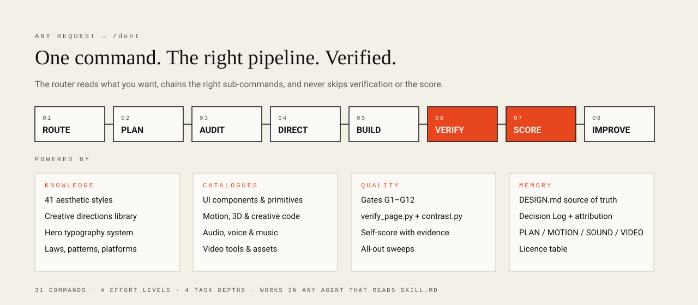
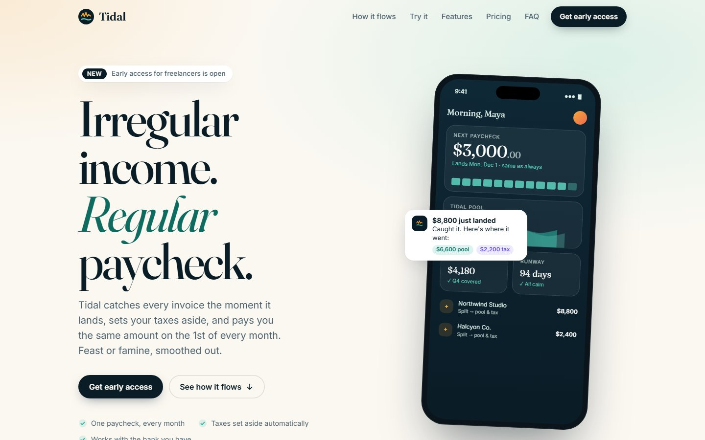
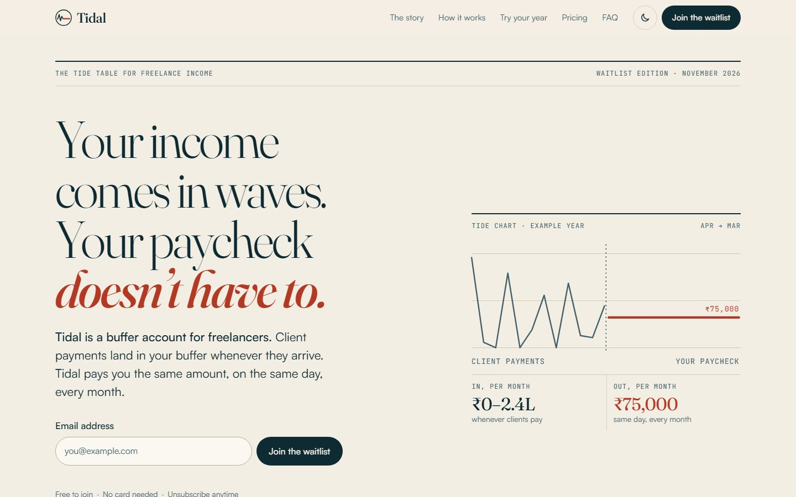
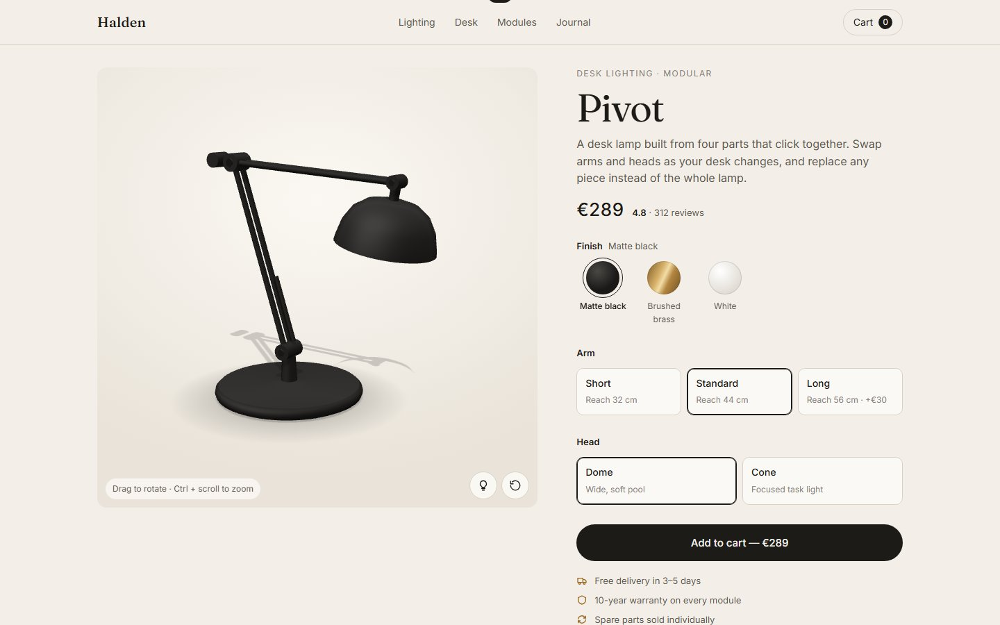
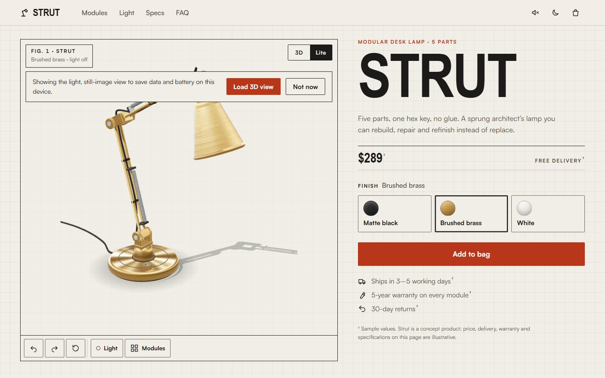
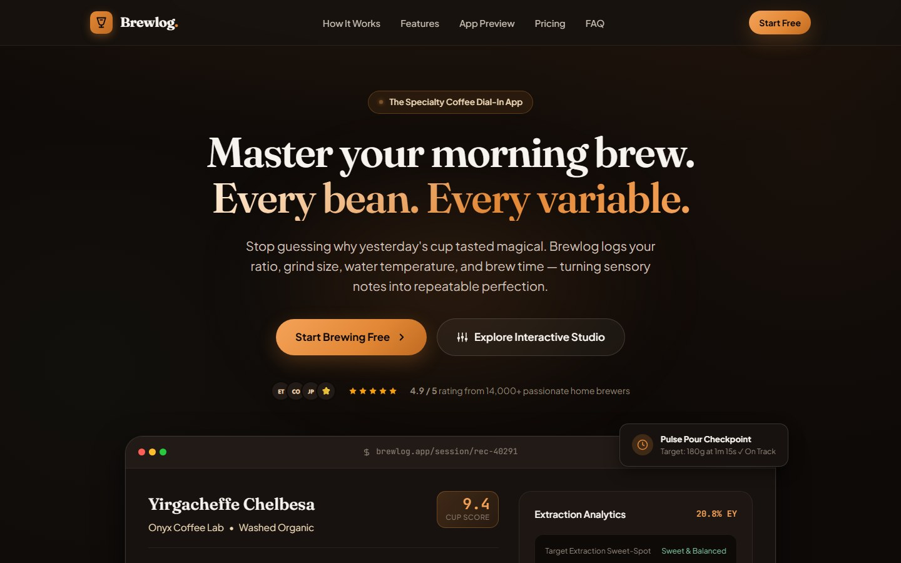
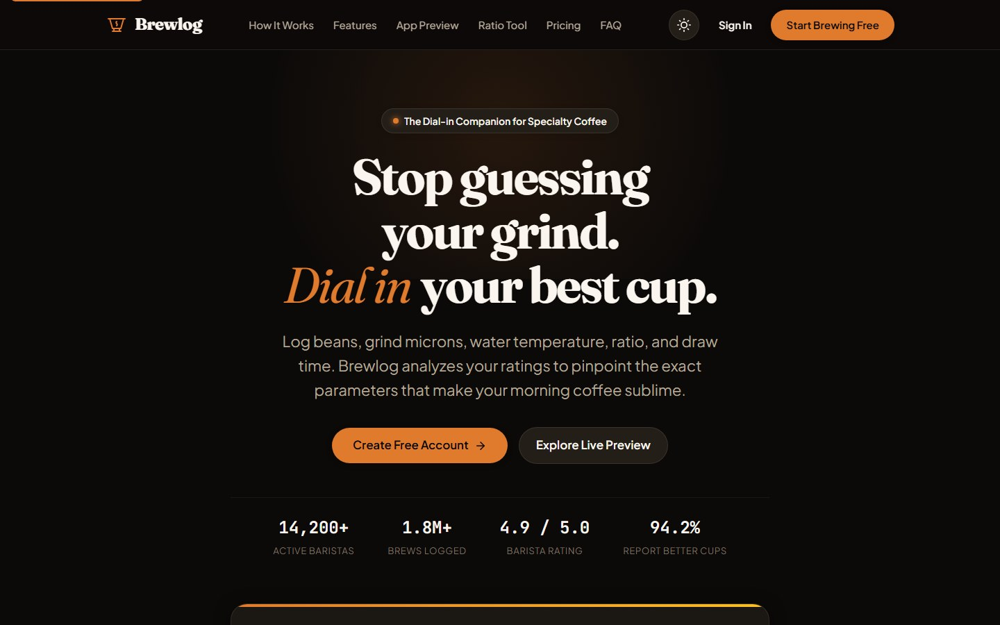
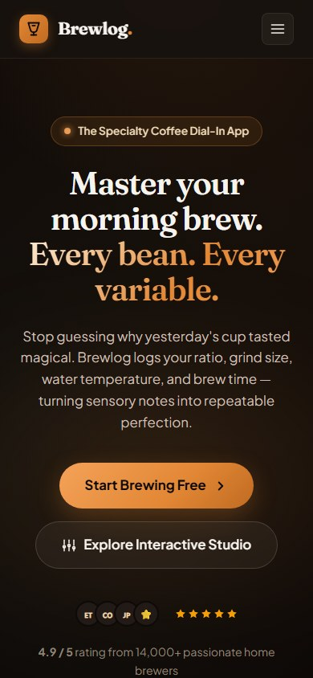
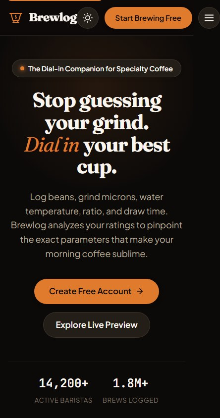

<a href="#install">
<picture>
  <source media="(prefers-color-scheme: dark)" srcset="assets/hero-dark.svg">
  
</picture>
</a>

**DENT is an open-source design-engineering skill for AI agents.** Install it once and your agent (Claude Code, Codex, Cursor, Copilot, Gemini CLI, Antigravity, or anything that reads `SKILL.md`) designs like a senior product designer, builds like a front-end engineer, animates like a motion designer, and scores like a strict reviewer. Interfaces, motion graphics, 3D, sound, narration and video.

[](LICENSE)
[](https://agentskills.io)
[](CHANGELOG.md)
[](skills/dent/references/styles/_styles-index.md)
[](docs/COMMANDS.md)

**[Install](#install)** · **[One command](#one-command-the-right-pipeline)** · **[What it can make](#what-dent-can-make)** · **[Proof](#see-the-difference-run-the-benchmark)** · **[Commands](docs/COMMANDS.md)** · **[Architecture](docs/ARCHITECTURE.md)**

---

## The problem

Ask any agent for a landing page and you get the average of every template: a violet gradient, a glowing orb, a centered headline, three equal cards, invented "loved by 10,000+ teams" stats, and a phone layout that scrolls sideways. It looks finished for a second and forgettable forever.

**DENT changes how the agent works, not just what it outputs.**

| Without DENT | With DENT 2.0 |
|---|---|
| Guesses the look from one sentence | Classifies the task, asks the few questions that matter, or decides for you and shows why |
| The category cliché | Names the cliché, then diverges: concept, one of 41 styles, a directions library, a signature hero |
| Invents social proof | **Never.** Honesty is a gate: real proof or clearly marked placeholders |
| "Looks fine on my screen" | `verify_page.py` checks overflow at 6 widths, contrast, labels, reduced motion, autoplay audio |
| Adds a second UI library to your repo | Detects your design system and extends it; picks libraries from sourced catalogues, licences included |
| Fades everything in | Motion with a purpose, storyboards for motion graphics, reduced-motion versions |
| Click sounds everywhere, autoplaying music | Sound as a designed, opt-in system; narration with captions |
| "Done!" | Scores itself against *your* request with evidence; `/dent:improve` raises the score |

---

## One command. The right pipeline.

<picture>
  <source media="(prefers-color-scheme: dark)" srcset="assets/workflow-dark.svg">
  
</picture>

You never have to learn the commands. Type `/dent` (or just describe what you want) and DENT's router works out the deliverable, the state of your project, the media involved and the risk, then chains the right sub-commands:

```text
/dent go all out: a landing page for my app and a 45-second launch video with voice-over
```
→ *two pipelines, one shared design system:* `directions → create → type → motion-graphics → assets → verify → score → improve`, then `launch-video → voice → sound → verify → score`.

```text
/dent this dashboard scrolls sideways on my phone
```
→ `responsive → verify`. No questionnaire for a bug.

Power users can call any of the [30 commands](docs/COMMANDS.md) directly: `/dent:plan`, `/dent:audit`, `/dent:components`, `/dent:motion-graphics`, `/dent:sound`, `/dent:video`, `/dent:score`, `/dent:improve`…

---

## What DENT can make

| Discipline | What DENT brings |
|---|---|
| **Product design** | Six modes (create, redesign, audit, extend, implement, adopt), 4 effort levels, 4 task depths, UX laws labelled Law / Rule / Convention, recipes for landing pages, apps and dashboards |
| **Creative direction** | Concept sentence, category-cliché check, 41 aesthetic styles, a [library of 25 named directions](skills/dent/references/creative/directions-library.md) plus motion, sound and video directions, a [hero typography system](skills/dent/references/creative/hero-typography.md) with 18 composition techniques |
| **Front-end engineering** | Tokens first, ~45 component specs, code guides for HTML/CSS, Tailwind, React, Vue, Svelte, Flutter, SwiftUI, Compose, React Native |
| **Component intelligence** | A [sourced catalogue](skills/dent/references/catalog/README.md) of primitives (Radix, Base UI, React Aria, Ark…), systems (MUI, Mantine, Ant, Carbon, Fluent…), collections (shadcn/ui, Magic UI, Aceternity…) and specialists (TanStack Table, AG Grid, Tiptap, cmdk, Sonner, dnd-kit, React Flow…), with licences and paid tiers called out |
| **Motion graphics** | Interface motion vs motion graphics vs 3D, 1D → 2D → 2.5D → 3D → XR, storyboards, kinetic type, scroll stories, generative visuals, and a tech ladder from CSS to GSAP, Rive, PixiJS, Three.js and shaders |
| **Sound and voice** | UI sound, sonic identity, ambience, interactive and procedural audio, music, narration and TTS, captions; never autoplay, always opt-in |
| **Video** | Launch (teaser, reveal, feature tour, manifesto), trailers, explainers, demos, social, ads; scripts, storyboards, animatics; generative tools if you have them, otherwise HyperFrames, Remotion, Motion Canvas and FFmpeg |
| **Quality** | 12 gates, runnable checks, an [All-out protocol](skills/dent/references/workflow/all-out.md) that misses nothing, request-specific self-scoring, and attribution of what came from DENT vs the agent vs you |

---

## Built with DENT 2.0

The next showcase pieces are being produced **with DENT 2.0 itself**, using the exact prompts in [`evals/scenarios.md`](evals/scenarios.md) (S19–S21). Every question the agent asks and every answer given will be published with the result.

| Piece | Status |
|---|---|
| DENT's own landing page | Next |
| A kinetic-typography motion piece about DENT | Next |
| A 60–75 s explainer video with narration and captions | Next |

The animated banner at the top of this page is hand-built SVG: the wordmark is drawn as paths, it plays once, and it respects reduced-motion settings. Its source is [`assets/build_assets.py`](assets/build_assets.py).

---

## See the difference: run the benchmark

Don't take our word for it. Give your agent the **same prompt twice**, once without DENT and once with it, and compare the two websites. We publish every result: wins, ties and losses.

**How to run either benchmark**
1. Use the same agent, model and settings for both runs, each in a **fresh session** and an **empty folder**.
2. **Run A, without DENT:** skill not installed. **Run B, with DENT:** skill installed ([install](#install)).
3. Paste the prompt unchanged. Apart from answering the agent's questions (benchmark 1 only), reply only `continue` if it stops early. Keep the first result of each run.
4. Open both `index.html` files side by side on your phone and desktop, and share your screenshots via a pull request or a [Benchmark result issue](https://github.com/jeelnadaa/DENT/issues/new?template=benchmark_result.md).

Full rules, scoring sheet and a screenshot script: **[benchmark/](benchmark/README.md)** · Full test protocol: **[evals/protocol.md](evals/protocol.md)**

### Latest results: 8 builds with and without DENT (Claude Opus 5.5)

Same agent (Claude Code), same model (Claude Opus 5.5, medium effort), same prompt, built twice: once without DENT and once with DENT 2.0. Full summary: **[RESULTS-SUMMARY.md](benchmark/RESULTS-SUMMARY.md)**.

| Test | Without DENT | With DENT | Comparable? |
|---|---|---|---|
| [Brewlog marketing site](benchmark/results/brewlog-claude-code-opus-5.5-medium-2026-11-14/RESULT.md) | 38 | **44** | Yes |
| [SaaS analytics dashboard](benchmark/results/saas-dashboard-claude-code-opus-5.5-medium-2026-11-14/RESULT.md) | 39 | **43** | Yes |
| [Checkout with failure recovery](benchmark/results/checkout-flow-claude-code-opus-5.5-medium-2026-11-14/RESULT.md) | 39 | **44** | Partly |
| [Kanban + command palette + drawer](benchmark/results/project-app-claude-code-opus-5.5-medium-2026-11-14/RESULT.md) | 37 | **43** | Partly |
| [Scroll-story launch page](benchmark/results/scroll-story-launch-claude-code-opus-5.5-medium-2026-11-14/RESULT.md) | 37 | **45** | Partly |
| [Meditation timer with sound](benchmark/results/meditation-sound-claude-code-opus-5.5-medium-2026-11-14/RESULT.md) | 39 | **44** | Partly |
| [3D product viewer](benchmark/results/3d-product-viewer-claude-code-opus-5.5-medium-2026-11-14/RESULT.md) | 36 | **44** | Partly |
| [45 s launch video](benchmark/results/launch-video-claude-code-opus-5.5-medium-2026-11-14/RESULT.md) | 38 | **43** | Partly |
| **Average (/50)** | **37.9** | **43.8** | |

| | Without DENT | With DENT |
|---|---|---|
| Scroll-story launch page |  |  |
| 3D product viewer |  |  |

**What the numbers say, honestly:**
- **Automated checks:** all 7 web builds with DENT passed every automated gate. All 7 without DENT failed at least one: text contrast in all 7, animation that ignores reduced motion in 3, an unlabeled input in 1.
- **Honesty:** one build without DENT invented "4.8 · 312 reviews". None of the DENT builds invented proof.
- **Why the gap isn't bigger:** Opus 5.5 is a very strong model, and its pages are good on their own. DENT's lift shows most in correctness, distinctiveness (a concept instead of the template look) and process (plans, specs, self-checks). Expect a bigger gap with smaller models.
- **Caveats:** the scores come from Claude Opus 5.5, the same model family and DENT's author, so they are not independent. Six of the eight DENT runs got a higher effort level, design feedback or extra features; every difference is listed in [DEVIATIONS](benchmark/results/DEVIATIONS-claude-code-opus-5.5-medium-2026-11-14.md). Human reviews are welcome.

### Benchmark 1: DENT's own landing page, built with DENT

We are building DENT's landing page with DENT itself. Here is the exact prompt, so you can build it **with and without DENT** and compare.

This prompt gives the agent the **content** (headlines, copy, links) and nothing about the look. It also **lets the agent ask questions**, the way real requests work: answer them briefly, and give the same answers in both runs where the questions overlap.

```text
Build the landing page for DENT, an open-source product design skill for AI coding agents.
Put it in a single self-contained index.html (HTML, CSS and JavaScript inline; Google Fonts
allowed; no other external files, frameworks or images, so build any visuals with HTML, CSS
or inline SVG). It must work well on phones, tablets and desktops.

Every "Download" or "Get DENT" button links to https://github.com/jeelnadaa/DENT and opens
in a new tab.

Use this content. You may shorten or rephrase it lightly and choose the order of sections,
but keep the facts accurate and don't invent statistics, testimonials, logos or user counts.

PRODUCT
- Name: DENT
- Tagline: Make a dent with your product's design.
- What it is: a free, open-source skill (a folder with a SKILL.md file) that gives AI coding
  agents the judgment of a senior product designer.
- Works with: Claude Code, OpenAI Codex, Cursor, GitHub Copilot, Gemini CLI, OpenCode and any
  agent that supports Agent Skills (SKILL.md). Also Claude.ai and Claude Desktop.
- License: Apache 2.0. Created by Jeel Nada (solarquack).

HERO
- Headline: AI agents can build anything. Now they can design it, too.
- Subheadline: DENT is an open-source design skill that makes your AI agent ask the right
  questions, follow proven UX laws and accessibility rules, and ship interfaces that don't
  look like every other AI-made site.
- Primary button: Download on GitHub (link above)
- Secondary button: See how it works (scrolls to the "How it works" section)
- Small note under the buttons: Free and open source · Apache 2.0 · Works with Claude Code,
  Codex, Cursor, Copilot and more

THE PROBLEM
- Heading: Every AI-made website looks the same.
- Body: Ask an agent for a landing page and you get the usual: a purple gradient, a centered
  headline, three feature cards, one font at one weight, missing states and text you can
  barely read. It works for a second and looks like everything else forever.

WITHOUT DENT vs WITH DENT (a comparison)
- Guesses the look from one sentence → Asks a few focused questions, or decides for you if
  you say so
- Default template look → A clear concept, a deliberate style and a signature element
- One-off values everywhere → Design tokens and components reused on every screen
- Happy path only → Empty, loading, error, success, hover, focus and disabled states
- "Looks accessible" → WCAG 2.2 AA rules no style is allowed to break
- Adds a second design system to your codebase → Detects your existing UI library and
  extends it
- "I picked blue because it's nice" → A decision log with the reason behind every choice
- Forgets everything next session → An approved DESIGN.md that becomes the source of truth

HOW IT WORKS (5 steps)
1. Ask: DENT asks how far to go, then only the questions that matter, one at a time, each
   with a recommended answer.
2. Direct: it picks a concept and a style on purpose, not by default.
3. Build: tokens first, then components with every state, then screens.
4. Check: it reviews its own work against a quality checklist and, when the agent can,
   takes screenshots and fixes what's wrong.
5. Document: once you approve, everything goes into DESIGN.md so the next change stays
   consistent.

FEATURES
- Four effort levels: Essential, Standard, Polished and All-out. You choose the depth.
- 41 aesthetic styles: from Minimal, Swiss and Editorial to Neo-Brutalism, Glassmorphism,
  Japandi, Dark Tech, Retro OS and Cyberpunk, each with rules for doing it well.
- Proven principles: Gestalt, Fitts's Law, Hick's Law, Jakob's Law and Nielsen's heuristics,
  applied for you.
- Accessibility built in: contrast, touch targets, keyboard and focus, reduced motion.
- Works with your code: detects shadcn/ui, MUI, Chakra, Tailwind and your existing tokens,
  and extends them.
- Design to code: HTML/CSS, Tailwind, React, Vue, Svelte, Flutter, SwiftUI, Jetpack Compose
  and React Native.
- Six modes: create, redesign, audit, extend, implement, and adopt an existing design system.
- Real product patterns: landing pages, pricing, dashboards, onboarding, checkout, settings,
  AI and chat interfaces, billing, roles, docs sites and more.

STYLES SHOWCASE
- Heading: 41 styles. Zero templates.
- Show a sample of style names: Minimal, Swiss, Editorial, Luxury, Japandi, Neo-Brutalism,
  Glassmorphism, Dark Tech, Bento, Utilitarian, Retro OS, Y2K, Synthwave, Cyberpunk,
  Terminal, Pixel Art, plus "and 25 more".

BENCHMARK
- Heading: Don't take our word for it.
- Body: We give an AI agent the same prompt twice, once without DENT and once with it, and
  publish both results: wins, ties and losses. This page itself was built with DENT. Run the
  benchmark yourself and share what you get.
- Button: Run the benchmark (link: https://github.com/jeelnadaa/DENT/tree/main/benchmark)

INSTALL
- Heading: Install in one line.
- Show these as copyable commands, each with a copy button:
  - Any agent: npx skills add jeelnadaa/DENT
  - Claude Code: /plugin marketplace add jeelnadaa/DENT  then  /plugin install dent@dent
- Note: Or download the folder from GitHub and drop it into your agent's skills directory.
  Full guide: https://github.com/jeelnadaa/DENT/blob/main/docs/INSTALL.md

FAQ
- Is DENT free? Yes. It's open source under the Apache 2.0 license, including for
  commercial work.
- Which agents does it work with? Any agent that supports Agent Skills (SKILL.md): Claude
  Code, Codex, Cursor, GitHub Copilot, Gemini CLI, OpenCode and more. For other agents you
  can point a rules file at it.
- Will it slow my agent down? DENT loads one main file and opens its detailed guides only
  when a task needs them.
- Do I own what I design with it? Yes. DENT claims no rights over your designs.
- Can it work on my existing app? Yes. It detects your existing design system and extends
  it, or audits your current UI and ranks what to fix.
- Can I contribute? Yes. New styles, patterns and fixes are welcome on GitHub.

FINAL CALL TO ACTION
- Heading: Give your agent taste.
- Body: Install DENT in a minute and ask for your next screen.
- Button: Download on GitHub (link above)

FOOTER
- DENT · Make a dent with your product's design.
- Links: GitHub (https://github.com/jeelnadaa/DENT) · Install guide · Benchmark · License
  (https://github.com/jeelnadaa/DENT/blob/main/LICENSE)
- Created by Jeel Nada (solarquack). Apache 2.0.

When you are done, give me a short summary of the design decisions you made.
```

**Results: DENT landing page**

| Agent + model | Without DENT | With DENT | Run by |
|---|---|---|---|
| *Official results coming soon* | | | [@jeelnadaa](https://github.com/jeelnadaa) |

Prompt file and run notes: [benchmark/PROMPT-DENT-LANDING.md](benchmark/PROMPT-DENT-LANDING.md)

### Benchmark 2: "Brewlog", a one-shot website

A fictional coffee app. This prompt never mentions DENT and tells the agent not to ask questions, so both runs are one-shot and directly comparable.

```text
Build a complete, production-quality marketing website for "Brewlog", a fictional app
for home coffee brewers. Brewlog lets people log brew recipes (beans, grind size, water
temperature, ratio, time), rate each cup, and see which settings make their best coffee
over time. It has a free plan and a paid "Pro" plan ($6/month or $60/year) that adds
unlimited recipes, bean inventory tracking and brew analytics.

Requirements:
- One self-contained file named index.html (HTML, CSS and JavaScript inline). Web fonts
  from Google Fonts are allowed. No other external files, frameworks or images: build any
  visuals (product screenshots, illustrations, icons) with HTML, CSS or inline SVG.
- Sections: a header with navigation, hero, how it works, key features, a preview of the
  app's interface, pricing (Free vs Pro, monthly/yearly), FAQ, a sign-up form, and a footer.
- The sign-up form asks for name, email and password, validates in the browser and shows
  helpful errors and a success state. It does not need a backend.
- It must look great and work well on phones, tablets and desktops.

Make every decision yourself and don't ask me any questions. When you are done, reply with
a short summary of the design decisions you made.
```

**Results: Brewlog**

**Run 1: Antigravity + Gemini 3.8 Flash (High effort)**, 2026-11-14, run by [@jeelnadaa](https://github.com/jeelnadaa)

| | Without DENT | With DENT |
|---|---|---|
| Desktop |  |  |
| Phone |  |  |
| Full page | [Desktop](benchmark/results/brewlog-antigravity-gemini-3.8-flash-high-2026-11-14/without-1440.jpg) · [Phone](benchmark/results/brewlog-antigravity-gemini-3.8-flash-high-2026-11-14/without-390.jpg) | [Desktop](benchmark/results/brewlog-antigravity-gemini-3.8-flash-high-2026-11-14/with-1440.jpg) · [Phone](benchmark/results/brewlog-antigravity-gemini-3.8-flash-high-2026-11-14/with-390.jpg) |
| Live site | [Open](https://jeelnadaa.github.io/DENT/benchmark/results/brewlog-antigravity-gemini-3.8-flash-high-2026-11-14/without/index.html) | [Open](https://jeelnadaa.github.io/DENT/benchmark/results/brewlog-antigravity-gemini-3.8-flash-high-2026-11-14/with/index.html) |
| Score (/50) | **36** | **35** |

**Honest verdict: about a tie.** On this model both runs produced a very similar dark espresso-and-orange site. DENT clearly improved the process: a written brief and concept, a full `DESIGN.md`, reduced-motion support, a light/dark theme and clearer pricing states. But it also shipped a sideways-scrolling header on phones and kept invented stats that its own rules forbid, so the run without DENT scored slightly higher (36 vs 35; the without-DENT page also overflows at 320 px and ignores reduced motion). We're fixing both in the skill. Full scores, checks and notes: **[RESULT.md](benchmark/results/brewlog-antigravity-gemini-3.8-flash-high-2026-11-14/RESULT.md)**

*More runs on other agents and models are welcome. One run per side isn't enough to call a winner.*

**What DENT 2.0 changed because of this run:** every failure above is now an enforced gate (overflow, honesty, labels, style mixing, category cliché, proofreading), the [landing-page recipe](skills/dent/references/recipes/landing-page.md) walks the agent through them step by step, and `verify_page.py` catches the mechanical ones automatically (its raw output for both pages is in the result folder). The next Brewlog run will use DENT 2.0.

---

## Install

**Claude Code (plugin, gets all 30 slash commands)**
```bash
/plugin marketplace add jeelnadaa/DENT
```
```bash
/plugin install dent@dent
```

**Any agent, one command** (detects Claude Code, Codex, Cursor, Copilot, Gemini CLI, OpenCode…)
```bash
npx skills add jeelnadaa/DENT
```

**Manual:** copy `skills/dent/` into your agent's skills folder:

| Agent | Personal (all projects) | Project only |
|---|---|---|
| Claude Code | `~/.claude/skills/dent/` | `.claude/skills/dent/` |
| OpenAI Codex | `~/.codex/skills/dent/` | `.agents/skills/dent/` |
| GitHub Copilot | `~/.copilot/skills/dent/` | `.github/skills/dent/` |
| Cursor | `~/.cursor/skills/dent/` | `.cursor/skills/dent/` |
| Gemini CLI | `~/.gemini/skills/dent/` | `.gemini/skills/dent/` |
| Antigravity, OpenCode, Goose, Amp & other Agent Skills tools | — | `.agents/skills/dent/` |

Or run the installer: `./scripts/install.sh claude` (macOS/Linux) · `.\scripts\install.ps1 -Agent claude` (Windows).

**Claude.ai / Claude Desktop:** download `dent.zip` from [Releases](https://github.com/jeelnadaa/DENT/releases) and upload it under **Settings → Capabilities → Skills**. Agents without skill support (Windsurf, Cline, Aider, Zed…): see [docs/INSTALL.md](docs/INSTALL.md#agents-without-native-skill-support).

**Optional, for real verification:** `pip install playwright && python -m playwright install chromium` lets DENT run `verify_page.py` on what it builds.

> Skill folder paths change as tools evolve. If a path doesn't work, check your agent's docs for its "skills" directory. Full details: [docs/INSTALL.md](docs/INSTALL.md).

---

## Use it

Just ask. These all work with plain `/dent` or no command at all:

```text
Design a landing page for my meditation app.
Redesign our settings screen. Keep the brand colors.
Review this dashboard screenshot and tell me what's wrong.
Build the pricing page from DESIGN.md in Next.js + Tailwind.
Add sound to the app, but keep it subtle.
Make a 60-second explainer video with a calm narrator.
Go all out on an onboarding flow for a fintech app. Don't ask, just decide.
Score it. Then improve it.
```

**Effort levels:** Essential · Standard · Polished · **All-out**. All-out is a promise: the best achievable result for your use case with nothing missed, a mandatory completeness sweep, and self-review until the work scores 9/10 with evidence.

---

## Architecture

```
skills/dent/
├── SKILL.md            # the router: classify → route → gates → score (lean, always loaded)
├── commands/           # 30 command definitions (one source of truth per command)
├── references/         # loaded only when needed
│   ├── workflow/       # orchestration, planning + plan audit, execution, verification, scoring, all-out
│   ├── recipes/        # step-by-step procedures with gates (landing page, app & dashboard)
│   ├── creative/       # directions library, hero typography, anti-slop detector
│   ├── catalog/        # components, primitives, specialists, assets + selection method
│   ├── motion/         # motion graphics, tech catalogue, 3D, motion system + verification
│   ├── audio/          # sound design, voice & narration, audio tech, implementation + verification
│   ├── video/          # video types & craft, tools & pipeline
│   ├── styles/         # 41 aesthetic styles
│   └── *.md            # color, typography, accessibility, patterns, platforms, industries, tokens & code…
├── templates/          # PLAN, AUDIT, REVIEW, SCORECARD, MOTION, SOUND, VIDEO
└── scripts/            # verify_page.py, contrast.py
commands/               # Claude Code plugin wrappers → /dent:<name>
evals/                  # behaviour cases, 21 scenarios, command + routing tests, fixtures
benchmark/              # public with/without comparisons
```

Progressive disclosure keeps the agent's context small: `SKILL.md` is about 330 lines; the other 130+ files load only when a task needs them. More: [docs/ARCHITECTURE.md](docs/ARCHITECTURE.md).

---

## Verification and evaluation

- `python scripts/validate.py`: frontmatter, 400+ internal references, the styles index, the command trio (definition ↔ plugin wrapper ↔ router), 200+ catalogue entries with sources and status, and versions.
- `python scripts/test_tools.py`: `verify_page.py` must fail a deliberately broken page on every gate and pass a clean one.
- [`evals/`](evals/): 15 behaviour cases, 21 scenarios (dashboards, data-heavy apps, checkout, existing design systems, unfamiliar frameworks, strict accessibility, motion graphics, 3D, animated data, audiovisual, launch and explainer videos, sonic identity) and a protocol that records the prompt, **every question asked and the answer chosen**, the output, machine checks, self-score and an independent score.
- Catalogue licences are marked ✓ (checked against official sources on a date) or K (from knowledge, to verify), so DENT never presents a guess as a fact.

CI runs the validator, the tool tests and the packager on every push.

---

## Roadmap
- Publish the three showcase pieces built with DENT 2.0 (landing page, motion piece, explainer).
- Re-run Brewlog with DENT 2.0, plus runs on more agents and models.
- More recipes (mobile app, e-commerce, docs site, email) and more verified catalogue entries.
- Motion verification tooling (frame-rate capture, timeline checks) alongside `verify_page.py`.

Ideas and results are welcome: see [CONTRIBUTING.md](CONTRIBUTING.md).

---

## Creator

DENT was created by **Jeel Nada**, known online as **solarquack** · GitHub [@jeelnadaa](https://github.com/jeelnadaa).
If DENT helps you ship something, a ⭐ on the repo or a mention is the best thank-you.

## License

DENT is licensed under the [Apache License 2.0](LICENSE). You may use, modify and distribute it, commercially too, as long as you keep the license and the [NOTICE](NOTICE) file (which credits the creator). The license does **not** grant rights to the DENT name or logo; see [TRADEMARKS.md](TRADEMARKS.md).

Designs you create with DENT are yours. DENT claims no rights over its output.
