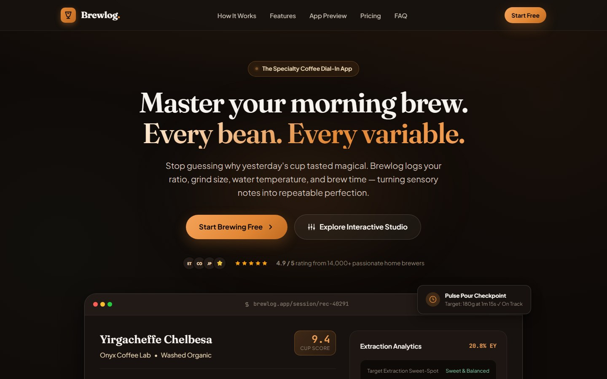
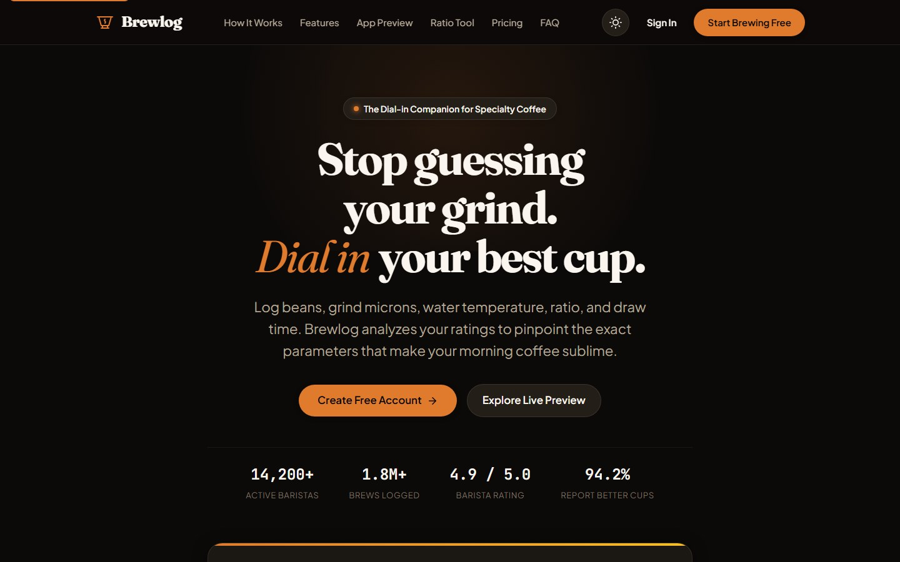
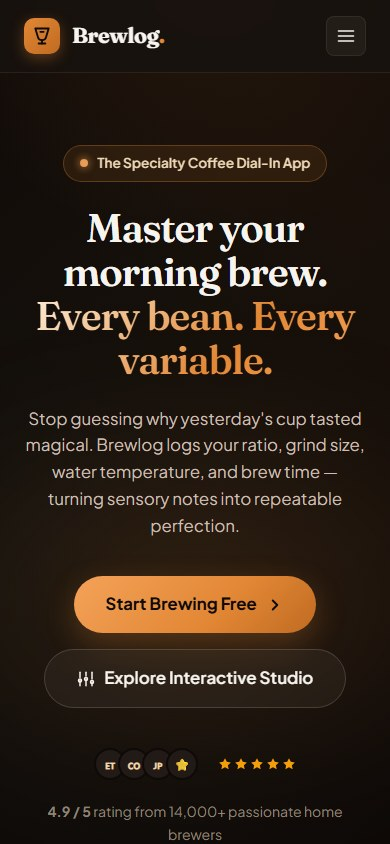
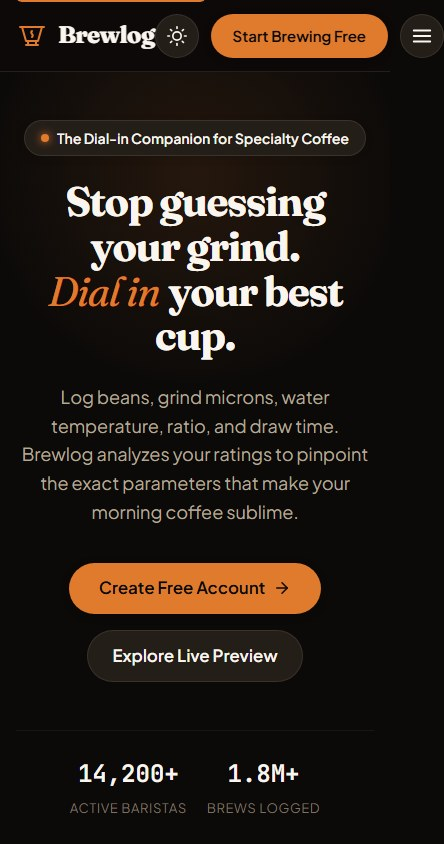

# Benchmark result: Antigravity + Gemini 3.8 Flash (High)

| | |
|---|---|
| **Run by** | Jeel Nada ([@jeelnadaa](https://github.com/jeelnadaa)) |
| **Date** | 2026-11-14 |
| **Agent** | Antigravity |
| **Model & settings** | Gemini 3.8 Flash, High effort |
| **Prompt** | Brewlog v1 |
| **DENT version** | 1.0.1 |
| **Reviewed by** | Claude (Opus 5.5), from screenshots at 390px and 1440px plus automated checks on both `index.html` files; re-checked with DENT 2.0's `verify_page.py` at 6 widths |

**Verdict: about a tie. DENT did not clearly win this run.** Both sites came out as dark espresso-and-orange pages with a serif display face and very similar section structure. DENT changed the *process* visibly (brief, concept, decision log, `DESIGN.md`, reduced-motion support, light/dark theme, cleaner pricing states), but it also shipped a real mobile layout bug and kept the invented social proof that DENT's own rules forbid.

## First screen

| | Without DENT | With DENT |
|---|---|---|
| Desktop (1440px) |  |  |
| Phone (390px) |  |  |

Full pages: [without, desktop](without-1440.jpg) · [with, desktop](with-1440.jpg) · [without, phone](without-390.jpg) · [with, phone](with-390.jpg)

Source: [without/index.html](without/index.html) · [with/index.html](with/index.html) · [with/DESIGN.md](with/DESIGN.md) (the design spec the DENT run produced)

## Scores (1–5)

| # | Criterion | Without | With | Notes |
|---|---|---|---|---|
| 1 | Clarity | 4 | 4 | Both say what Brewlog is and what to do within seconds. |
| 2 | Hierarchy | 4 | 4 | One primary button per section in both. |
| 3 | Layout & spacing | 4 | 3 | With: the hero's extraction-curve panel is mostly empty space; the 4-step pour row is cramped on phones. |
| 4 | Typography | 4 | 4 | Same idea in both (serif display + grotesk + mono numbers). With has a nice italic "Dial in" accent. |
| 5 | Color | 4 | 4 | Nearly identical palettes. |
| 6 | Consistency | 4 | 4 | Both consistent. With has a copy typo ("Target Target Pour"). |
| 7 | States & feedback | 3 | 4 | Without marks features the Free plan *doesn't* include with check marks (struck through). With uses ×, adds a password show/hide toggle and a light/dark switch. |
| 8 | Accessibility | 3 | 3 | Without: animations keep running under reduced motion; sampled text contrast failures. With: has reduced-motion support, but 2 range sliders in the "Dial-in Radar" tab have no label, several small labels fail contrast, and the mobile menu button is pushed off-screen. |
| 9 | Mobile | 3 | 2 | **With scrolls sideways on every phone width** (444px page at 320/375/390; header actions and the ratio calculator overflow; the menu button is cut off). Without fits at 375/390 but overflows at 320px (pricing cards, 357px). |
| 10 | Distinctiveness | 3 | 3 | Both have the same "dark specialty coffee" look; neither feels unmistakably *Brewlog*. |
| | **Total (/50)** | **36** | **35** | |

## Automated checks

| | Without | With |
|---|---|---|
| Horizontal overflow (320/375/390/768/1024/1440) | Only at 320px (357px wide; pricing cards) | **At 320, 375 and 390px** (444px wide; `.nav-actions`, calculator) |
| `prefers-reduced-motion` handled | No (3 animations keep running) | Yes (0 running) |
| Sampled text-contrast failures | 2 | 5 (small labels in the demo and stats) |
| Inputs without a label | 0 | 2 (range sliders in an inactive tab) |
| Images without alt text | 0 | 0 |
| Visible `:focus-visible` styles | Yes | Yes |
| Light/dark theme | Dark only | Both, with toggle |

Raw machine-check output (DENT 2.0 `verify_page.py`): [verify-without.json](verify-without.json) · [verify-with.json](verify-with.json)

## What DENT clearly changed
- Wrote a brief, a concept ("The Precision Alchemist's Field Journal for Specialty Coffee"), design principles and a full [DESIGN.md](with/DESIGN.md) with tokens and a decision log.
- Added reduced-motion support, a theme switch and clearer pricing states (× for excluded features).
- Added a working brew-ratio calculator as a product demo.

## Where DENT fell short (and what we'll fix in the skill)
1. **Invented social proof.** The DENT run made up four stats ("14,200+ active baristas", "1.8M+ brews", "4.9 / 5.0", "94.2%"). The run without DENT also invented a "4.9/5 from 14,000+" rating. DENT's rules say never to do this, so the rule isn't strong enough yet.
2. **No mobile overflow check.** DENT's review step includes "nothing overflows horizontally", but the agent didn't catch the 444px-wide header. The verification step needs to be harder to skip.
3. **Style mixing.** DESIGN.md lists three styles combined (Editorial + Bento + "Cupertino-Clean"); DENT allows one base plus at most one accent.
4. **Same look as without.** For a coffee product on this model, both runs landed on the same palette and type. DENT's "avoid the default look" guidance didn't push the design further apart.
5. Both runs used a real person's name ("James Hoffmann") as a form placeholder.

## Observations
- On this model, DENT's effect showed up more in process and robustness (spec, states, motion preferences, themes) than in a different-looking visual design.
- One run per side isn't enough to call a winner. More runs on other agents and models will show whether this holds.
