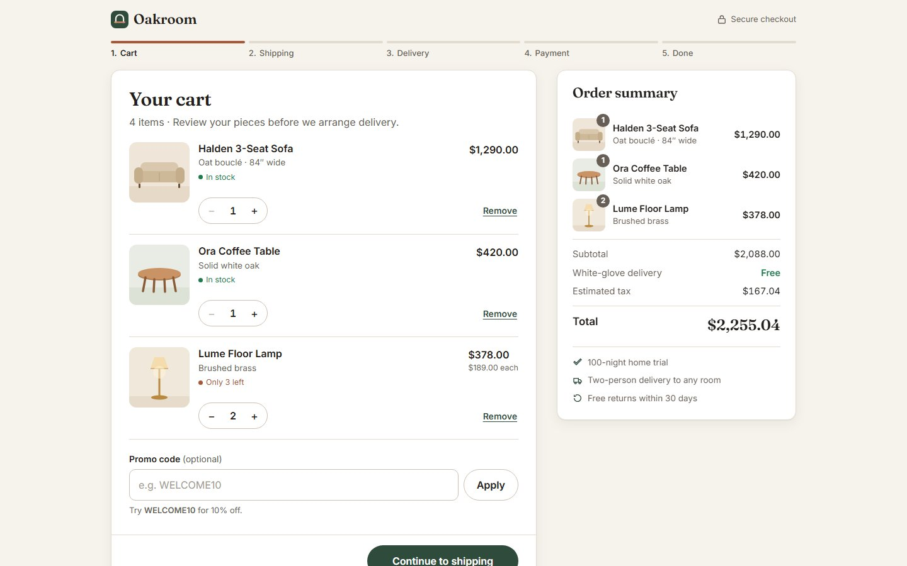
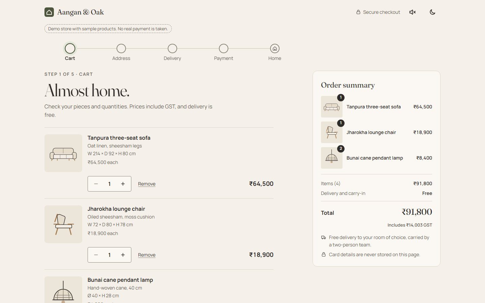
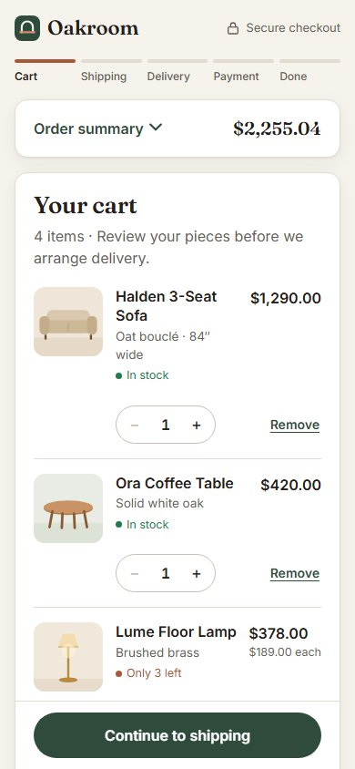
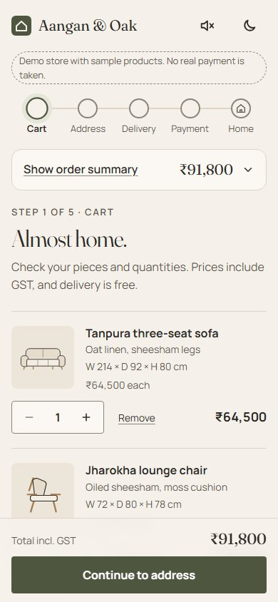

# Benchmark result: Multi-step checkout with failure recovery

| | |
|---|---|
| **Agent** | Claude Code (desktop app) |
| **Model** | Claude Opus 5.5, medium effort |
| **Date** | 2026-11-14 |
| **DENT version** | 2.0.0 (plugin) |
| **Runs** | Without DENT (prompt forbids it; plugin still installed) and with DENT (`/dent`) |
| **Reviewed by** | Claude Opus 5.5: the same model family that built both versions, and DENT's author. **This is not an independent review.** Human scores are welcome via a Benchmark result issue. |

**Score: without DENT 39/50 · with DENT 44/50.**

**Comparability:** Not directly comparable: the with-DENT run was set to All-out (not Standard), for the Indian market (₹, GST), with opt-in sounds.

**Verdict:** Both handle the flow well. With DENT: a 'quiet showroom' direction with drawn product illustrations, a clear stepper, a demo-store notice, and a full plan, design spec and scorecard.

## First screen

| | Without DENT | With DENT |
|---|---|---|
| Desktop (1440px) |  |  |
| Phone (390px) |  |  |

Full pages: [without, desktop](without-1440.jpg) · [with, desktop](with-1440.jpg) · [without, phone](without-390.jpg) · [with, phone](with-390.jpg)

Live: [without DENT](https://jeelnadaa.github.io/DENT/benchmark/results/checkout-flow-claude-code-opus-5.5-medium-2026-11-14/without/index.html) · [with DENT](https://jeelnadaa.github.io/DENT/benchmark/results/checkout-flow-claude-code-opus-5.5-medium-2026-11-14/with/index.html)

## Machine checks (`verify_page.py`, 6 widths)

| | Without DENT | With DENT |
|---|---|---|
| Automated gates (G2, G3, G4, G10, G11) | failed G3 | all 5 passed |
| Horizontal overflow | none | none |
| Sampled contrast failures | 1 | 0 |
| Unlabeled controls | 0 | 0 |
| Animations running (normal / reduced motion) | 0 / 0 | 0 / 0 |
| Audio before a user gesture | 0 | 0 |
| Console errors | 0 | 0 |

Raw output: [verify-without.json](verify-without.json) · [verify-with.json](verify-with.json)

## Scores (1–5)

| # | Criterion | Without | With |
|---|---|---|---|
| 1 | Clarity | 4 | 5 |
| 2 | Hierarchy | 4 | 4 |
| 3 | Layout & spacing | 4 | 4 |
| 4 | Typography | 4 | 5 |
| 5 | Color | 4 | 4 |
| 6 | Consistency | 4 | 5 |
| 7 | States & feedback | 4 | 5 |
| 8 | Accessibility | 3 | 4 |
| 9 | Mobile | 4 | 4 |
| 10 | Distinctiveness | 4 | 4 |
| | **Total (/50)** | **39** | **44** |

## Notes

- Contrast: 1 sampled failure without DENT, 0 with.

## Files
- `without/` and `with/`: the delivered files (agents' internal work folders excluded).
- `with/PLAN.md`, `with/DESIGN.md`, `with/SCORECARD.md` where the run produced them; `QA.md` holds the questions DENT asked and the answers given.
- Every deviation from the brief: [DEVIATIONS-claude-code-opus-5.5-medium-2026-11-14.md](../DEVIATIONS-claude-code-opus-5.5-medium-2026-11-14.md)
