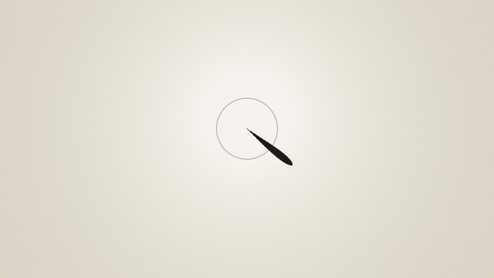
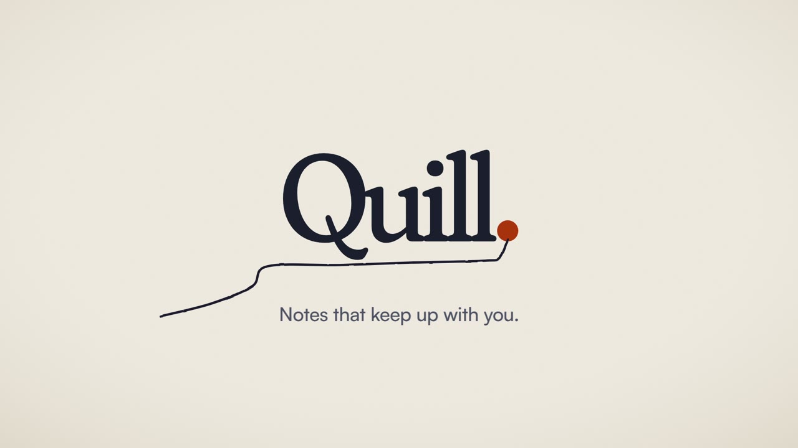

# Benchmark result: 45-second launch video

| | |
|---|---|
| **Agent** | Claude Code (desktop app) |
| **Model** | Claude Opus 5.5, medium effort |
| **Date** | 2026-11-14 |
| **DENT version** | 2.0.0 (plugin) |
| **Runs** | Without DENT (prompt forbids it; plugin still installed) and with DENT (`/dent`) |
| **Reviewed by** | Claude Opus 5.5: the same model family that built both versions, and DENT's author. **This is not an independent review.** Human scores are welcome via a Benchmark result issue. |

**Score: without DENT 38/50 · with DENT 43/50.**

**Comparability:** Not directly comparable: the with-DENT run used narration (the brief said music + captions only), 16:9 + 9:16 (the brief said 16:9 + 1:1), and All-out effort with user feedback.

**Verdict:** Both are clean, code-rendered 45 s films with synthesised music (nothing to license). Without DENT: a solid product tour, but the UI text is small on phones and loudness sits at −15.4 LUFS. With DENT: stronger kinetic type ('Good ideas don't wait.'), an ink-line motif, designed burned-in captions, narration, and exactly −14 LUFS.

## Frames (at 9 s)

| Without DENT | With DENT |
|---|---|
|  |  |

Watch: [without, 16:9](https://jeelnadaa.github.io/DENT/benchmark/results/launch-video-claude-code-opus-5.5-medium-2026-11-14/without/quill-launch-16x9.mp4) · [without, 1:1](https://jeelnadaa.github.io/DENT/benchmark/results/launch-video-claude-code-opus-5.5-medium-2026-11-14/without/quill-launch-1x1.mp4) · [with, 16:9](https://jeelnadaa.github.io/DENT/benchmark/results/launch-video-claude-code-opus-5.5-medium-2026-11-14/with/quill-launch-16x9.mp4) · [with, 9:16](https://jeelnadaa.github.io/DENT/benchmark/results/launch-video-claude-code-opus-5.5-medium-2026-11-14/with/quill-launch-9x16.mp4) (sound on for the DENT version's narration)

## Scores (1–5)

| # | Criterion | Without | With |
|---|---|---|---|
| 1 | Hook (first 2 s) | 4 | 4 |
| 2 | Message clarity | 4 | 5 |
| 3 | Typography | 4 | 5 |
| 4 | Visual consistency | 4 | 4 |
| 5 | Motion craft | 4 | 4 |
| 6 | Sound & mix | 4 | 5 |
| 7 | Captions | 4 | 5 |
| 8 | Legibility on phones | 3 | 4 |
| 9 | Spec compliance | 4 | 3 |
| 10 | Distinctiveness | 3 | 4 |
| | **Total (/50)** | **38** | **43** |

## Notes

- Without DENT: 1920×1080 + 1080×1080, −15.4 LUFS, peak −1.4 dBFS. With DENT: 1920×1080 + 1080×1920, −14.0 LUFS, peak −2.9 dBFS.
- With DENT ships a VIDEO.md plan, a QA report and a scorecard (8.4, below its own All-out target of 9).

## Files
- `without/` and `with/`: the delivered files (agents' internal work folders excluded).
- `with/PLAN.md`, `with/DESIGN.md`, `with/SCORECARD.md` where the run produced them; `QA.md` holds the questions DENT asked and the answers given.
- Every deviation from the brief: [DEVIATIONS-claude-code-opus-5.5-medium-2026-11-14.md](../DEVIATIONS-claude-code-opus-5.5-medium-2026-11-14.md)
