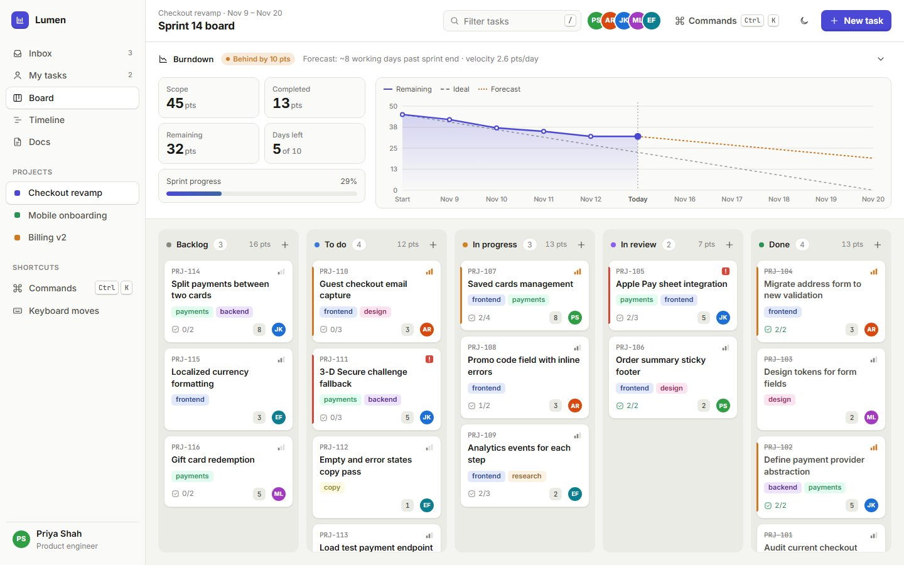
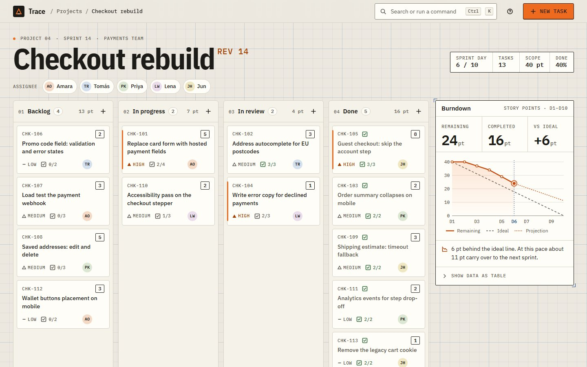
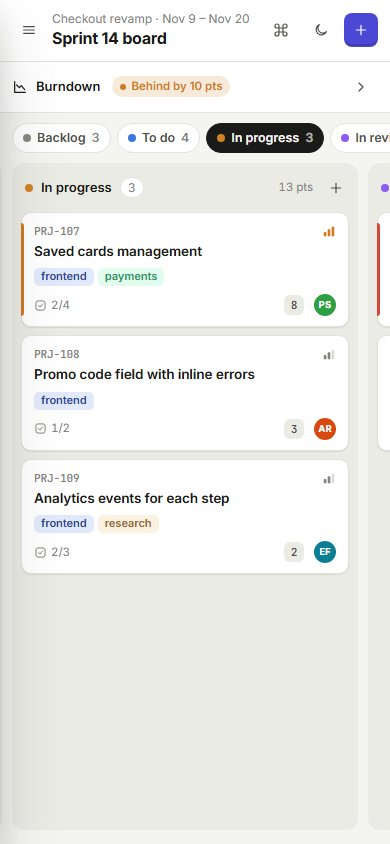
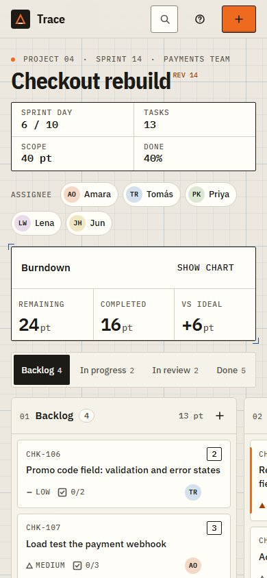

# Benchmark result: Kanban + command palette + drawer + chart

| | |
|---|---|
| **Agent** | Claude Code (desktop app) |
| **Model** | Claude Opus 5.5, medium effort |
| **Date** | 2026-11-14 |
| **DENT version** | 2.0.0 (plugin) |
| **Runs** | Without DENT (prompt forbids it; plugin still installed) and with DENT (`/dent`) |
| **Reviewed by** | Claude Opus 5.5: the same model family that built both versions, and DENT's author. **This is not an independent review.** Human scores are welcome via a Benchmark result issue. |

**Score: without DENT 37/50 · with DENT 43/50.**

**Comparability:** With DENT ran at Standard, one level below the intended Polished. No scorecard; DESIGN.md was written only when asked.

**Verdict:** Without DENT: a capable Linear-style board. With DENT: a 'drafting table' identity with a huge project title, numbered columns and a burndown with a table alternative. Its run found and fixed 4 bugs before delivery.

## First screen

| | Without DENT | With DENT |
|---|---|---|
| Desktop (1440px) |  |  |
| Phone (390px) |  |  |

Full pages: [without, desktop](without-1440.jpg) · [with, desktop](with-1440.jpg) · [without, phone](without-390.jpg) · [with, phone](with-390.jpg)

Live: [without DENT](https://jeelnadaa.github.io/DENT/benchmark/results/project-app-claude-code-opus-5.5-medium-2026-11-14/without/index.html) · [with DENT](https://jeelnadaa.github.io/DENT/benchmark/results/project-app-claude-code-opus-5.5-medium-2026-11-14/with/index.html)

## Machine checks (`verify_page.py`, 6 widths)

| | Without DENT | With DENT |
|---|---|---|
| Automated gates (G2, G3, G4, G10, G11) | failed G3, G4 | all 5 passed |
| Horizontal overflow | none | none |
| Sampled contrast failures | 11 | 0 |
| Unlabeled controls | 1 | 0 |
| Animations running (normal / reduced motion) | 1 / 0 | 0 / 0 |
| Audio before a user gesture | 0 | 0 |
| Console errors | 0 | 0 |

Raw output: [verify-without.json](verify-without.json) · [verify-with.json](verify-with.json)

## Scores (1–5)

| # | Criterion | Without | With |
|---|---|---|---|
| 1 | Clarity | 4 | 4 |
| 2 | Hierarchy | 4 | 5 |
| 3 | Layout & spacing | 4 | 4 |
| 4 | Typography | 4 | 5 |
| 5 | Color | 4 | 4 |
| 6 | Consistency | 4 | 4 |
| 7 | States & feedback | 4 | 4 |
| 8 | Accessibility | 2 | 4 |
| 9 | Mobile | 4 | 4 |
| 10 | Distinctiveness | 3 | 5 |
| | **Total (/50)** | **37** | **43** |

## Notes

- Without DENT: 11 sampled contrast failures and an unlabeled command-palette input. With DENT: 0 and 0.
- With DENT: the touch drag grip is 40 px instead of 44 (it reported this itself).

## Files
- `without/` and `with/`: the delivered files (agents' internal work folders excluded).
- `with/PLAN.md`, `with/DESIGN.md`, `with/SCORECARD.md` where the run produced them; `QA.md` holds the questions DENT asked and the answers given.
- Every deviation from the brief: [DEVIATIONS-claude-code-opus-5.5-medium-2026-11-14.md](../DEVIATIONS-claude-code-opus-5.5-medium-2026-11-14.md)
