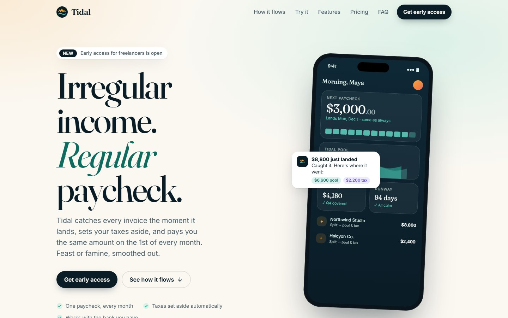
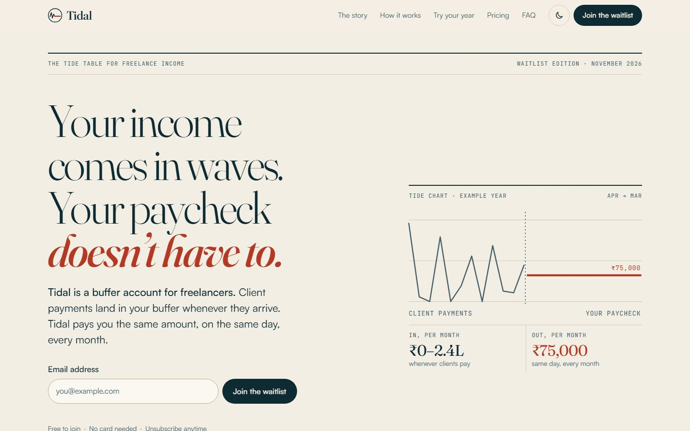
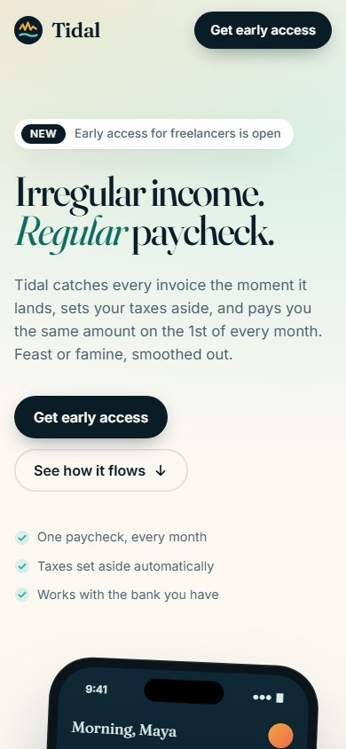
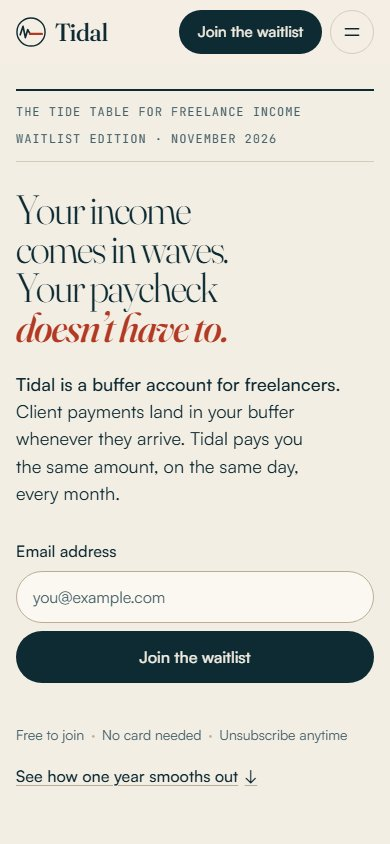

# Benchmark result: Launch page with a scroll story (All-out)

| | |
|---|---|
| **Agent** | Claude Code (desktop app) |
| **Model** | Claude Opus 5.5, medium effort |
| **Date** | 2026-11-14 |
| **DENT version** | 2.0.0 (plugin) |
| **Runs** | Without DENT (prompt forbids it; plugin still installed) and with DENT (`/dent`) |
| **Reviewed by** | Claude Opus 5.5: the same model family that built both versions, and DENT's author. **This is not an independent review.** Human scores are welcome via a Benchmark result issue. |

**Score: without DENT 37/50 · with DENT 45/50.**

**Comparability:** Both runs were asked for All-out. The with-DENT run added an optional ocean sound (off by default), ₹ pricing placeholders, and Satoshi body text (user feedback).

**Verdict:** Without DENT: strong type, but the textbook launch template (NEW pill, phone mockup, gradient). With DENT: a 'tide almanac' editorial concept with an income chart going from spiky to steady, bracketed placeholder pricing, and a self-score of 8.7 below its own target of 9.

## First screen

| | Without DENT | With DENT |
|---|---|---|
| Desktop (1440px) |  |  |
| Phone (390px) |  |  |

Full pages: [without, desktop](without-1440.jpg) · [with, desktop](with-1440.jpg) · [without, phone](without-390.jpg) · [with, phone](with-390.jpg)

Live: [without DENT](https://jeelnadaa.github.io/DENT/benchmark/results/scroll-story-launch-claude-code-opus-5.5-medium-2026-11-14/without/index.html) · [with DENT](https://jeelnadaa.github.io/DENT/benchmark/results/scroll-story-launch-claude-code-opus-5.5-medium-2026-11-14/with/index.html)

## Machine checks (`verify_page.py`, 6 widths)

| | Without DENT | With DENT |
|---|---|---|
| Automated gates (G2, G3, G4, G10, G11) | failed G3, G10 | all 5 passed |
| Horizontal overflow | none | none |
| Sampled contrast failures | 2 | 0 |
| Unlabeled controls | 0 | 0 |
| Animations running (normal / reduced motion) | 5 / 1 | 0 / 0 |
| Audio before a user gesture | 0 | 0 |
| Console errors | 0 | 0 |

Raw output: [verify-without.json](verify-without.json) · [verify-with.json](verify-with.json)

## Scores (1–5)

| # | Criterion | Without | With |
|---|---|---|---|
| 1 | Clarity | 4 | 5 |
| 2 | Hierarchy | 4 | 5 |
| 3 | Layout & spacing | 4 | 4 |
| 4 | Typography | 4 | 5 |
| 5 | Color | 4 | 4 |
| 6 | Consistency | 4 | 4 |
| 7 | States & feedback | 4 | 4 |
| 8 | Accessibility | 3 | 5 |
| 9 | Mobile | 4 | 4 |
| 10 | Distinctiveness | 2 | 5 |
| | **Total (/50)** | **37** | **45** |

## Notes

- Without DENT: animations keep running under reduced motion; 2 contrast failures. With DENT: all gates pass.

## Files
- **Published-copy change (licence):** the run self-hosted Satoshi `.woff2` files. Satoshi's ITF Free Font License allows self-hosting on your own site but not redistribution through public repositories, so in this repo copy the three files were removed and the same font is loaded from Fontshare's official CSS API instead. Nothing else was changed; the original is unchanged in the test lab.
- `without/` and `with/`: the delivered files (agents' internal work folders excluded).
- `with/PLAN.md`, `with/DESIGN.md`, `with/SCORECARD.md` where the run produced them; `QA.md` holds the questions DENT asked and the answers given.
- Every deviation from the brief: [DEVIATIONS-claude-code-opus-5.5-medium-2026-11-14.md](../DEVIATIONS-claude-code-opus-5.5-medium-2026-11-14.md)
